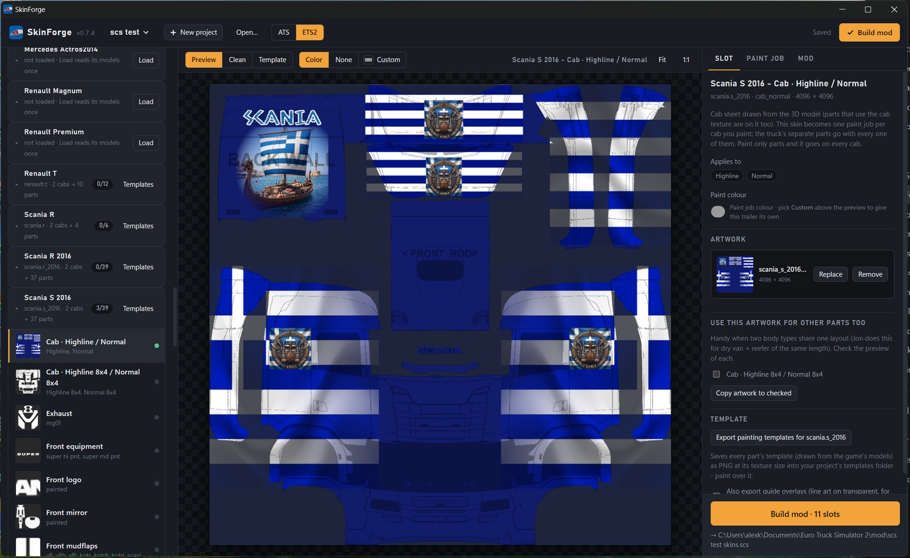
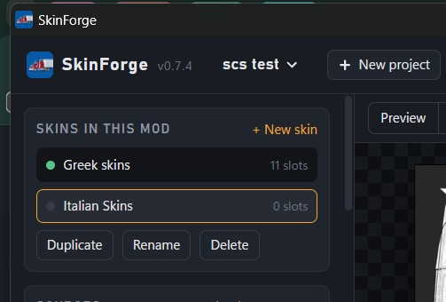
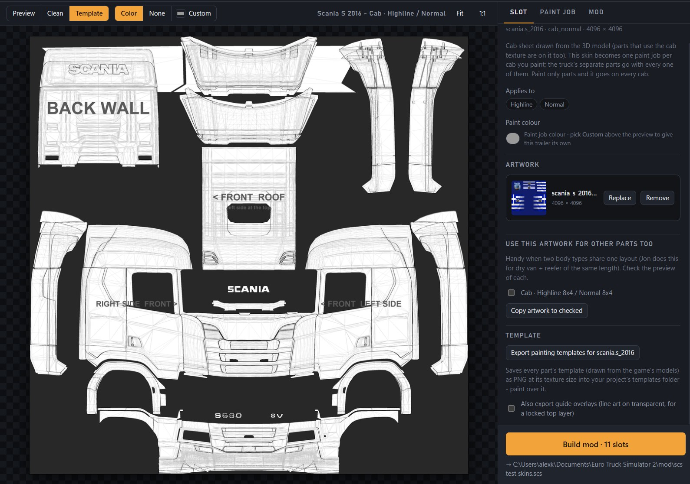

# SkinForge user guide

SkinForge builds paint job mods (skins) for Euro Truck Simulator 2 and American Truck
Simulator. You paint on a template and drop your image in. SkinForge then writes the
finished `.scs` mod straight into your game's mod folder.

---

## 1. Install and start

1. Download `SkinForge.exe` from the [Releases](../../releases) page. There's nothing to
   install, so put the file wherever you like.
2. Double-click it. Windows may show a blue SmartScreen box because the exe isn't
   code-signed. Click **More info**, then **Run anyway**.
3. SkinForge opens in its own window. Closing the window quits it.

The first start can take a moment while it reads your packs. Your projects are saved
in `Documents\SkinForge\<project name>\`.

**Tip:** to pin it to the taskbar, right-click the SkinForge button while it's running
and choose **Pin to taskbar**.

---

## 2. The window at a glance

| Area | What it's for |
|---|---|
| **Header** | New project, Open…, the **ATS / ETS2** switch, **Build mod** |
| **Skins in this mod** (left, top) | The skins inside this mod. Add more with **+ New skin** |
| **Sources** (left) | The packs SkinForge reads: mod packs (**Choose .scs…**, **Find in mod folder**) and your extracted game files (**SCS game files…**) |
| **Vehicle list** (left) | Trailers and trucks found in your sources, each with its templates |
| **Preview** (middle) | **Preview** = your art on the template, **Clean** = art only, **Template** = the bare template. **Color / None / Custom** = the paint colour shown under your art |
| **Right panel** | **Slot** (the selected template), **Paint job** (name, price, finish), **Mod** (mod name, author, output folder) |

---

## 3. Your first trailer skin

1. **Pick the game.** Click **ATS** or **ETS2** in the header.
2. **Add the trailer mod.** Click **Find in mod folder**. SkinForge looks for packs that
   ship paint templates. You can also click **Choose .scs…** and pick the author's
   **Open Definition** file (for example Jon Ruda's trailer pack Open Definition).
3. **Export the templates.** In the vehicle list, click **Templates** next to the
   trailer. The template images are saved in `Documents\SkinForge\Templates\ATS` (or `ETS2`),
   one folder per truck or trailer, shared by all your projects.
4. **Paint.** Open the template in your paint program (Photoshop, Affinity, GIMP,
   Paint.NET…). Paint your design and export it as a **PNG at the same size**.
   * Transparent areas take the paint colour the player picks in the shop.
   * Painted areas stay exactly as you painted them.
5. **Drop it in.** Click the template in the vehicle list, then drag your PNG onto the
   preview. **Preview** shows how it sits on the template.
   * Two body types with the same layout? Use **Copy artwork to checked** in the Slot tab.
6. **Fill in the paint job.** In the **Paint job** tab, set the name players see in
   the shop, the price, and the finish: gloss, metallic, or both as two entries.
7. **Fill in the mod.** In the **Mod** tab, set the mod name and author.
8. Click **Build mod**. The `.scs` goes straight into your game's mod folder.
9. **Start the game,** enable the mod in the Mod Manager, and buy the paint job at a
   dealer or service shop. The game only finds new mods when it starts.

---

## 4. Truck skins and cabs

Trucks work the same way. Add the truck's **Open Definition** as a source, and the
truck appears under **Trucks** with one template per cab or variant.

* **Cabs this skin goes on** (Slot tab): tick exactly which cabs get your skin.
* **Use this artwork for other cabs too**: copies your art to cabs with the same
  layout. Compare their **Template** view first.
* **Separate parts** (bumpers, fenders, skirts, boxes…): some trucks paint these with
  their own texture. Each part has its own template. Parts you leave empty take the
  paint colour.
* **Upside-down or mirrored pieces** on a template: under **Mirrored pieces**, click
  **+ Mark mirrored pieces** and click each piece. **Templates** then also exports an
  `_upright.png` with those pieces the right way up. Paint that sheet and drop it on
  **Drop your upright sheet**. SkinForge flips the pieces back when it builds.
* **Logos** ("Your logo" textures in some truck packs): these show under
  **Your logo textures**. Drop your logo image on each one.

---

## 5. Several skins in one mod

One mod can hold many skins, for example a full company fleet or a country pack.

* **+ New skin** adds an empty skin. **Duplicate** copies the selected one, art
  included. **Rename** sets the shop name.
* Click a skin to work on it. The art you drop goes into that skin only.
* Each skin has its own name, artwork and shop icon. Price, finish and colour are
  shared by the whole mod.
* **Delete**: a skin that was never built is removed. A skin that was already
  released stays in the mod as plain paint, so players' saves don't break.

---

## 6. SCS's own trucks and trailers

SCS's own trucks and trailers come with no paint templates. SkinForge draws the
templates itself from the game's 3D models, with labels like *BACK WALL*, *ROOF*,
*RIGHT SIDE* and *FRONT*.

1. **Point SkinForge at your game.** It finds your Steam install by itself. If it doesn't,
   click **SCS game files…** and pick the game folder (e.g.
   `...\steamapps\common\American Truck Simulator`). Nothing needs extracting: the game's
   own archives and your DLC are read directly.
2. Under **SCS trailers**, **SCS trucks** and (ATS) **Road Trip cars**, click **Load** on a
   vehicle. The first load reads its models and takes a few seconds to a minute; after that
   it's cached.
3. **Texture size per vehicle:** the **2K / 4K / 8K** buttons above the preview set the size
   for the selected truck, trailer or car. The Paint job tab's Texture size is the default.
   Your artwork is scaled to that size when building - keep its shape (1:1, 2:1) the same as
   the template, and paint at the size you want to see (scaling up adds no detail).
4. **Templates:** the vehicle's **Templates** button exports its templates as PNG (Slot tab >
   Template size: same as the texture size, or 2K / 4K / 8K).
5. Each truck gets one **Cab** sheet per cab model, plus its separate parts (side
   skirts, fenders, sun visors, mirrors…). Paint them and build as usual.
   * You get one paint job per cab you painted. The parts go with every one of them.
   * Paint only parts, and the paint job goes on every cab.

**This truck / trailer / car · paint job** (Slot tab): give one vehicle its own finish
(Gloss / Metallic / Matte) and colour lock. Everything else follows the Paint job tab.

**Mod trucks and trailers without templates** (from open packs) get templates drawn
the same way. They show under **Mod trucks** and **Mod trailers**. Add the vehicle's
main pack too, because the Open Definition has no 3D models.

**AI traffic** (game folder): every SCS truck and trailer has two checkboxes in the Slot tab:
**Ownable** (a paint job you can buy for your own truck / trailer) and **AI traffic** (AI trucks
drive it / pull it with your livery). Tick one or both. Your art is carried over from the normal
template onto SCS's AI model, so you only paint once. Lights, glass and chrome stay SCS's own.

**Escort vehicles** (special transport): listed under **Escort vehicles**. SkinForge lays the
escort's body out again, like the escort templates skin authors make by hand: LEFT SIDE, RIGHT
SIDE, ROOF / HOOD, FRONT and REAR each get their own space, so lettering reads right on both
sides. The grey "inside" box is the bed and inner panels - a colour is enough there. Each skin
adds that escort, with your livery, to the vehicles that lead and follow oversize loads. The
first skin of each escort also replaces SCS's own escort of that model, so the escorts SCS
places itself (front, back, along the route) wear it too. Two mods that do this for the same
escort: the one higher in the mod manager wins.

**How often your AI vehicles show up** (Mod tab): compared with the SCS truck or trailer they
are copied from. There are dozens of trucks and trailers in traffic, so at 1x you see yours now
and then. Use "A lot (10x)" to check a build in game, then set it back before sharing.

**Template folder**: community template sets for SCS's trucks and trailers can replace
SkinForge's drawn templates. Download them from Trucky:

* ATS: <https://truckymods.io/american-truck-simulator/tools/truck-and-trailer-templates-898150>
* ETS2: <https://truckymods.io/euro-truck-simulator-2/tools/ets2-truck-and-trailer-templates-947834>

Unzip them anywhere. Click
**Template folder…** under Sources and pick that folder. Wherever a sheet there matches the
game's model, the Template view and **Templates** export use it. Matching goes by the shape of
the sheet's transparent area, not its file name - fully opaque PNGs never match. Building is the
same either way. The Slot tab says which sheet is used, and has a checkbox to go back to
SkinForge's labelled template. These sets are their authors' work: SkinForge doesn't ship them.

**Yard signs** (MattVT yards, SneaK's yards): put the yard's sign pack ("EDIT SIGN HERE.scs",
"SneaKs Master Def.scs") in your mod folder and SkinForge lists every sign under **Yard
signs**. Drop your image on a sign and build. In the mod manager, load your SkinForge mod
**above** the sign pack. You don't need to edit the sign pack any more.

**Dumper live floor**: SCS mapped its sides, top and underside onto one area. The template
says so: the same art shows on every face. A colour, a pattern or one logo works best.

**Yard sign templates**: put a PNG for a sign in your template folder and name it after the
sign - the texture name (`msdsign.png`) or its name in the list (`Manchester SD sign.png`).
After adding or renaming PNGs, click ↻ on the Template folder line.

**AI traffic trailers**: SCS trailers with traffic versions have an **AI traffic sheet** at
the top of their list. It's SCS's company-livery layout: the top half is the side (both sides
show it), the bottom row holds the ends (box trailer: rear doors, front wall and the roof;
tankers and dumpers: FRONT / REAR panels in orange boxes). Paint it like any template and build:
SCS's AI trucks then pull that trailer with your livery. Fill the side band right down to its
bottom edge. In the sheet's Slot tab you can choose which traffic lengths use it. Leave the
sheet empty and there's no AI traffic for that trailer.

**AI trucks**: an SCS truck's Slot tab has "AI traffic" - each cab you painted then also
drives around as an AI truck with your livery. The Mod tab sets how often your AI vehicles
show up.

**Bodies with their own settings**: on SCS trailers each body (53', 48'...) can have its own
finish, colour lock and colour (Slot tab → This body · paint job). It then becomes its own
paint job in the trailer shop, offered only on that body.

**Player company logos** (Logos & yard signs → Player company logos): your logo replaces one
of the game's company logos (the first eight). Any square PNG works - it's resized to the
game's size (128 × 128 in ATS); keep the design bold. Only one company-logo mod can be active.

---

## 7. Paint colour per template

The **Custom** button above the preview does two things: it shows a colour under your
art, and it saves that colour as this template's own paint colour (paste a hex code like
`#1a2b3c`, or use the eyedropper to pick a colour anywhere on screen). That colour
replaces the one in the Paint job tab. **Color** resets it to the Paint job tab colour.
**None** shows a checkerboard, so you can see which parts of your art are transparent.

---

## 8. Building and testing in game

* **Build mod** writes `<mod name>.scs` into the game's mod folder (Mod tab → output
  folder).
* Restart the game after each build. It only scans mods when it starts.
* In the Mod Manager, put your skin mod **above** the vehicle mod it's made for.
* The players of your skins need the original vehicle mod too. Your skin mod only
  holds your paint.
* **Unit code** (Mod tab): after the first build it's locked, because saved games
  remember the paint jobs by it. Rebuilding is always safe.

---

## 9. Common problems

| Problem | Fix |
|---|---|
| SmartScreen blocks the exe | **More info → Run anyway**, or build it yourself from the source |
| The window takes a while to open | The first start reads your packs and game files. Later starts are quicker |
| My trailer or truck isn't listed | Add the author's **Open Definition** .scs. A pack that ships no paint templates shows only under Mod trucks / Mod trailers |
| "Locked pack (SCS# format)" | The author locked that pack. Use their Open Definition instead |
| "No paintable parts" | The author baked the colours into the textures, so the game can't put a skin on that vehicle |
| "Its 3D models aren't in the loaded packs" | Add the vehicle's main .scs, not only the Open Definition |
| SCS truck parts are missing (painted logo, MG exhaust…) | Those parts come from a DLC you don't own, or you picked extracted files instead of the game install |
| Something went wrong | Mod tab > **Problems?** > *Save error report* and send the zip (log, settings, project - no artwork) |
| The skin doesn't show in game | Mod enabled? Above the vehicle mod? Game restarted after the build? |
| The paint job isn't offered for a cab | Check **Cabs this skin goes on** in the Slot tab |
| Pieces show up upside down in game | Mark them under **Mirrored pieces** and use the upright sheet (section 4) |
| My image is the wrong shape | Paint at the template's own size and shape. SkinForge warns when they don't match |

Found a bug? Open an issue on GitHub, or post in the forum thread.
