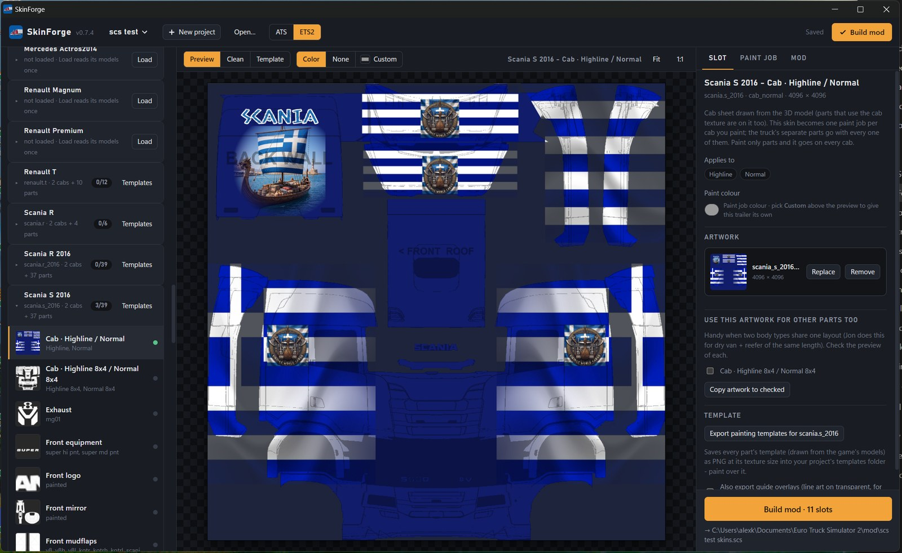
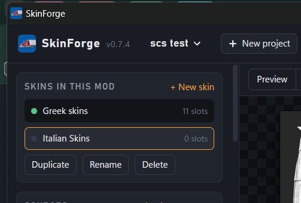
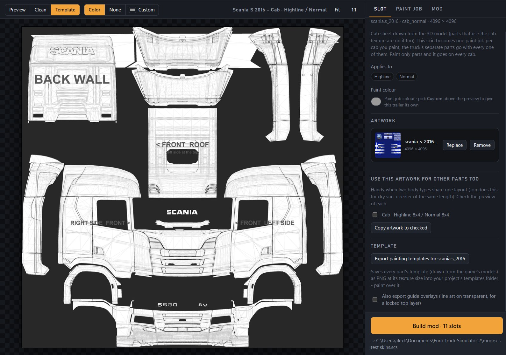

# SkinForge user guide

SkinForge builds paint job mods (skins) for Euro Truck Simulator 2 and American Truck
Simulator. You paint on a template and drop your image in. SkinForge then writes the
finished `.scs` mod straight into your game's mod folder.

---

## 1. Install and start

1. Download `SkinForge.exe` from the [Releases](../../releases) page. There's nothing to
   install, so put the file wherever you like.
2. Double-click it. Windows may show a blue SmartScreen box because the exe isn't
   code-signed. Click **More info**, then **Run anyway**.
3. SkinForge opens in its own window. Closing the window quits it.

The first start can take a moment while it reads your packs. Your projects are saved
in `Documents\SkinForge\<project name>\`.

**Tip:** to pin it to the taskbar, right-click the SkinForge button while it's running
and choose **Pin to taskbar**.

---

## 2. The window at a glance

| Area | What it's for |
|---|---|
| **Header** | New project, Open…, the **ATS / ETS2** switch, **Build mod** |
| **Skins in this mod** (left, top) | The skins inside this mod. Add more with **+ New skin** |
| **Sources** (left) | The packs SkinForge reads: mod packs (**Choose .scs…**, **Find in mod folder**) and your extracted game files (**SCS game files…**) |
| **Vehicle list** (left) | Trailers and trucks found in your sources, each with its templates |
| **Preview** (middle) | **Preview** = your art on the template, **Clean** = art only, **Template** = the bare template. **Color / None / Custom** = the paint colour shown under your art |
| **Right panel** | **Slot** (the selected template), **Paint job** (name, price, finish), **Mod** (mod name, author, output folder) |

---

## 3. Your first trailer skin

1. **Pick the game.** Click **ATS** or **ETS2** in the header.
2. **Add the trailer mod.** Click **Find in mod folder**. SkinForge looks for packs that
   ship paint templates. You can also click **Choose .scs…** and pick the author's
   **Open Definition** file (for example Jon Ruda's trailer pack Open Definition).
3. **Export the templates.** In the vehicle list, click **Templates** next to the
   trailer. The template images are saved in your project folder.
4. **Paint.** Open the template in your paint program (Photoshop, Affinity, GIMP,
   Paint.NET…). Paint your design and export it as a **PNG at the same size**.
   * Transparent areas take the paint colour the player picks in the shop.
   * Painted areas stay exactly as you painted them.
5. **Drop it in.** Click the template in the vehicle list, then drag your PNG onto the
   preview. **Preview** shows how it sits on the template.
   * Two body types with the same layout? Use **Copy artwork to checked** in the Slot tab.
6. **Fill in the paint job.** In the **Paint job** tab, set the name players see in
   the shop, the price, and the finish: gloss, metallic, or both as two entries.
7. **Fill in the mod.** In the **Mod** tab, set the mod name and author.
8. Click **Build mod**. The `.scs` goes straight into your game's mod folder.
9. **Start the game,** enable the mod in the Mod Manager, and buy the paint job at a
   dealer or service shop. The game only finds new mods when it starts.

---

## 4. Truck skins and cabs

Trucks work the same way. Add the truck's **Open Definition** as a source, and the
truck appears under **Trucks** with one template per cab or variant.

* **Cabs this skin goes on** (Slot tab): tick exactly which cabs get your skin.
* **Use this artwork for other cabs too**: copies your art to cabs with the same
  layout. Compare their **Template** view first.
* **Separate parts** (bumpers, fenders, skirts, boxes…): some trucks paint these with
  their own texture. Each part has its own template. Parts you leave empty take the
  paint colour.
* **Upside-down or mirrored pieces** on a template: under **Mirrored pieces**, click
  **+ Mark mirrored pieces** and click each piece. **Templates** then also exports an
  `_upright.png` with those pieces the right way up. Paint that sheet and drop it on
  **Drop your upright sheet**. SkinForge flips the pieces back when it builds.
* **Logos** ("Your logo" textures in some truck packs): these show under
  **Your logo textures**. Drop your logo image on each one.

---

## 5. Several skins in one mod

One mod can hold many skins, for example a full company fleet or a country pack.

* **+ New skin** adds an empty skin. **Duplicate** copies the selected one, art
  included. **Rename** sets the shop name.
* Click a skin to work on it. The art you drop goes into that skin only.
* Each skin has its own name, artwork and shop icon. Price, finish and colour are
  shared by the whole mod.
* **Delete**: a skin that was never built is removed. A skin that was already
  released stays in the mod as plain paint, so players' saves don't break.

---

## 6. SCS's own trucks and trailers

SCS's own trucks and trailers come with no paint templates. SkinForge draws the
templates itself from the game's 3D models, with labels like *BACK WALL*, *ROOF*,
*RIGHT SIDE* and *FRONT*.

1. **Point SkinForge at your game.** It finds your Steam install by itself. If it doesn't,
   click **SCS game files…** and pick the game folder (e.g.
   `...\steamapps\common\American Truck Simulator`). Nothing needs extracting: the game's
   own archives and your DLC are read directly.
2. Under **SCS trailers**, **SCS trucks** and (ATS) **Road Trip cars**, click **Load** on a
   vehicle. The first load reads its models and takes a few seconds to a minute; after that
   it's cached.
3. **Texture size per vehicle:** the **2K / 4K / 8K** buttons above the preview set the size
   for the selected truck, trailer or car. The Paint job tab's Texture size is the default.
   Your artwork is scaled to that size when building - keep its shape (1:1, 2:1) the same as
   the template, and paint at the size you want to see (scaling up adds no detail).
4. **Templates:** the vehicle's **Templates** button exports its templates as PNG (Slot tab >
   Template size: same as the texture size, or 2K / 4K / 8K).
5. Each truck gets one **Cab** sheet per cab model, plus its separate parts (side
   skirts, fenders, sun visors, mirrors…). Paint them and build as usual.
   * You get one paint job per cab you painted. The parts go with every one of them.
   * Paint only parts, and the paint job goes on every cab.

**This truck / trailer / car · paint job** (Slot tab): give one vehicle its own finish
(Gloss / Metallic / Matte) and colour lock. Everything else follows the Paint job tab.

**Mod trucks and trailers without templates** (from open packs) get templates drawn
the same way. They show under **Mod trucks** and **Mod trailers**. Add the vehicle's
main pack too, because the Open Definition has no 3D models.

---

## 7. Paint colour per template

The **Custom** button above the preview does two things: it shows a colour under your
art, and it saves that colour as this template's own paint colour. That colour
replaces the one in the Paint job tab. **Color** resets it to the Paint job tab colour.
**None** shows a checkerboard, so you can see which parts of your art are transparent.

---

## 8. Building and testing in game

* **Build mod** writes `<mod name>.scs` into the game's mod folder (Mod tab → output
  folder).
* Restart the game after each build. It only scans mods when it starts.
* In the Mod Manager, put your skin mod **above** the vehicle mod it's made for.
* The players of your skins need the original vehicle mod too. Your skin mod only
  holds your paint.
* **Unit code** (Mod tab): after the first build it's locked, because saved games
  remember the paint jobs by it. Rebuilding is always safe.

---

## 9. Common problems

| Problem | Fix |
|---|---|
| SmartScreen blocks the exe | **More info → Run anyway**, or build it yourself from the source |
| The window takes a while to open | The first start reads your packs and game files. Later starts are quicker |
| My trailer or truck isn't listed | Add the author's **Open Definition** .scs. A pack that ships no paint templates shows only under Mod trucks / Mod trailers |
| "Locked pack (SCS# format)" | The author locked that pack. Use their Open Definition instead |
| "No paintable parts" | The author baked the colours into the textures, so the game can't put a skin on that vehicle |
| "Its 3D models aren't in the loaded packs" | Add the vehicle's main .scs, not only the Open Definition |
| SCS truck parts are missing (painted logo, MG exhaust…) | Those parts come from a DLC you don't own, or you picked extracted files instead of the game install |
| Something went wrong | Mod tab > **Problems?** > *Save error report* and send the zip (log, settings, project - no artwork) |
| The skin doesn't show in game | Mod enabled? Above the vehicle mod? Game restarted after the build? |
| The paint job isn't offered for a cab | Check **Cabs this skin goes on** in the Slot tab |
| Pieces show up upside down in game | Mark them under **Mirrored pieces** and use the upright sheet (section 4) |
| My image is the wrong shape | Paint at the template's own size and shape. SkinForge warns when they don't match |

Found a bug? Open an issue on GitHub, or post in the forum thread.
